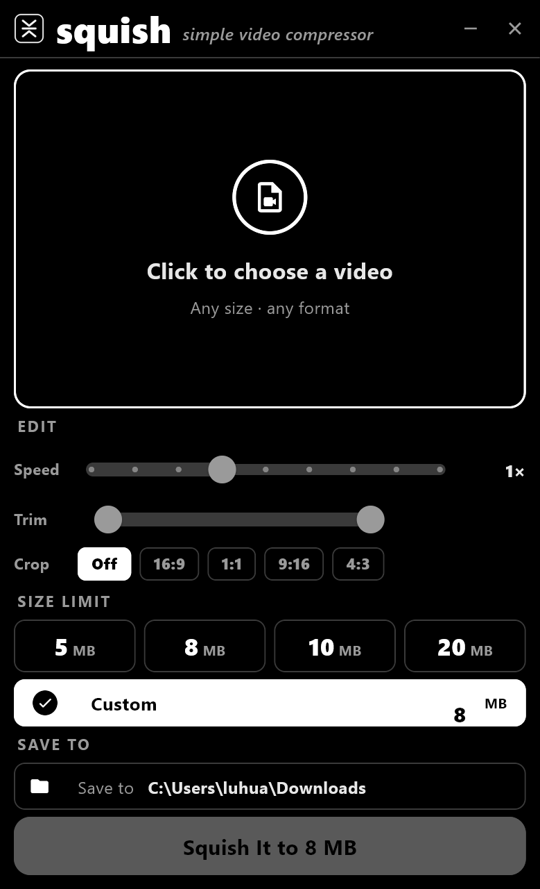
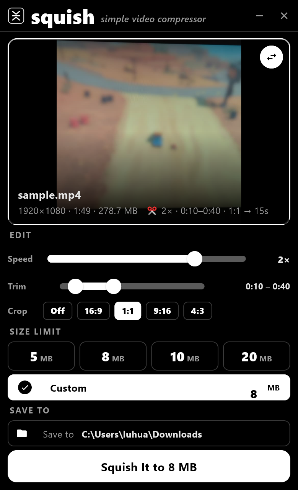
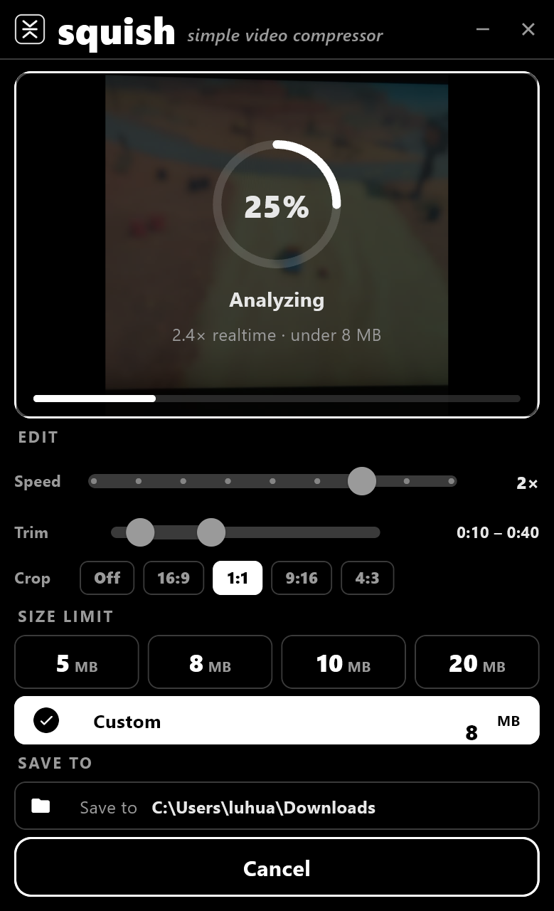
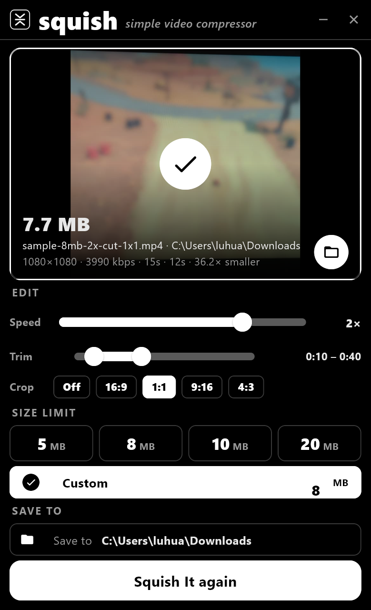
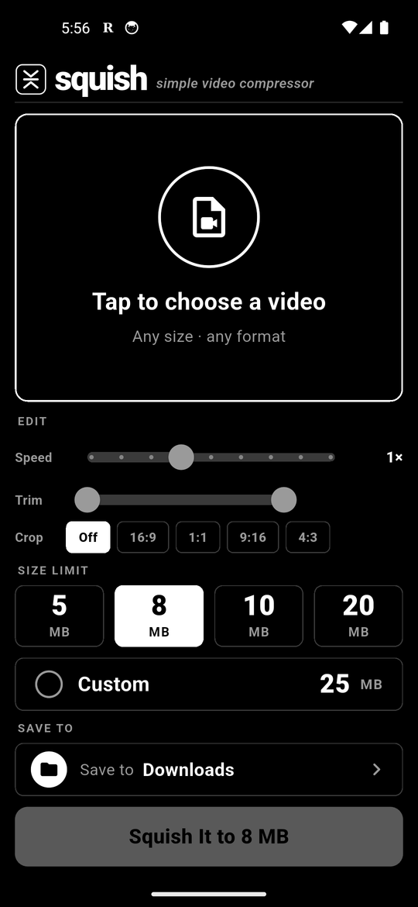
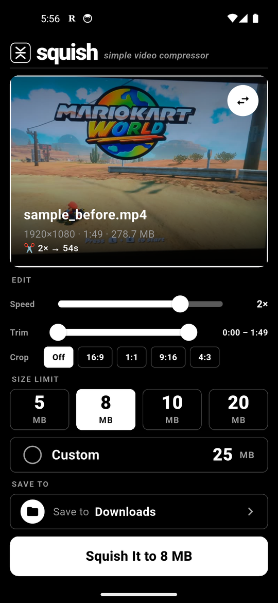
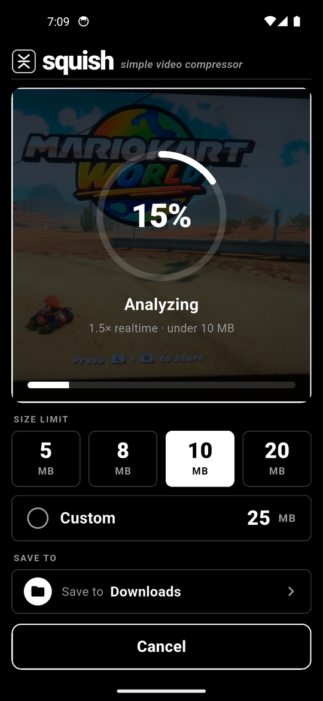
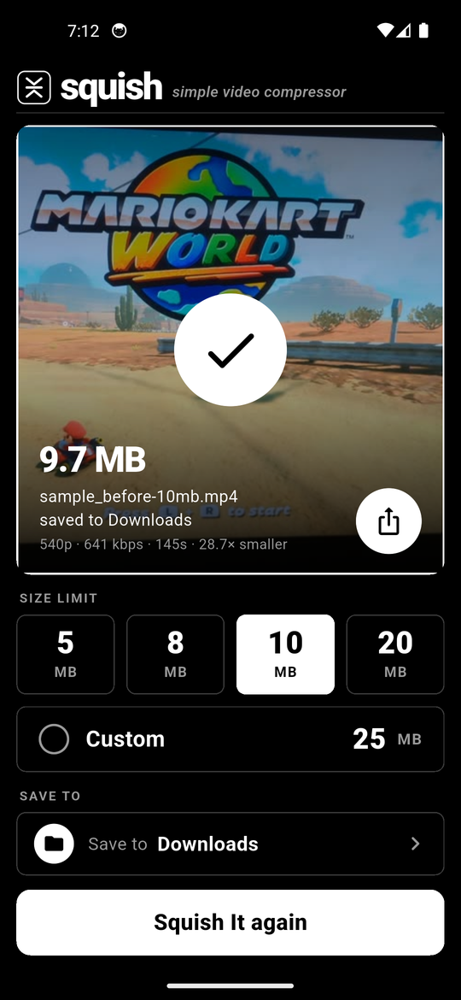

# squish — simple video compressor

Shrink any video to fit under a size limit (5 / 8 / 10 / 20 MB or custom), fully offline on your own machine.
Made for Discord uploads: the result is always strictly under the limit you pick, and the quality loss is
spread evenly so it still looks good. Windows exe and Android APK, same engine in both.

## Just want to use it?

Go to the **[Releases page](../../releases/latest)** and download:

| File | What it is |
|---|---|
| `Squish.exe` | Windows. One portable file, nothing to install. ffmpeg is built in. |
| `Squish.apk` | Android 8+. Install it, allow "unknown apps" if asked. |

**Windows:** put `Squish.exe` anywhere (for example `C:\Apps\`) and double-click it. Windows SmartScreen may show
"Windows protected your PC" the first time because the exe is not code-signed: click **More info → Run anyway**.

**Android:** open the APK from your Downloads, tap Install. Pick a video, pick a size, tap **Squish It**. The file
lands in your Downloads folder with `-10mb` (or whatever you chose) added to the name.

Quick run-through:

1. Click the big box to choose a video (any size, any format).
2. Optional **Edit**: speed (0.25x to 4x, audio pitch-corrected), trim (drag the two handles), crop
   (16:9, 1:1, 9:16, 4:3, centred). The preview updates and the size math uses the edited length.
3. Pick 5 / 8 / 10 / 20 MB, or type a custom number.
4. Optionally change **Save to** (defaults to your Downloads; the **Use Downloads** button brings it back).
5. **Squish It**. A 2-minute 1080p phone video takes about 15 s on a laptop, about 100 s on a phone.

The output name says what was done, e.g. `clip-8mb-2x-cut-1x1.mp4`.

## Screenshots

**Windows**

| Choose | Picked | Squishing | Done |
|---|---|---|---|
|  |  |  |  |

**Android**

| Choose | Picked | Squishing | Done |
|---|---|---|---|
|  |  |  |  |

## How it compresses

The recipe was reverse-engineered from [8mb.video](https://8mb.video)'s output and then improved:

1. Limit = N × 1,000,000 bytes, aimed 2.5 % under it, then the real file is measured and re-encoded tighter if needed.
   You never get exactly 20.0 MB.
2. Audio gets 128 / 96 / 64 / 48 kbps AAC depending on the total budget (copied untouched when the source already fits).
3. Video gets the rest. Resolution is the largest of 2160 / 1440 / 1080 / 720 / 540 / 480 / 360 / 240 that still
   receives at least 0.035 bits per pixel, so a 1080p clip squished to 20 MB becomes 720p, to 10 MB becomes 540p.
4. Two-pass x264 (not the single pass the website uses), MP4 with `faststart` so Discord previews instantly.
5. Edits are plain ffmpeg filters: `crop`, `setpts` + `atempo` for speed, and `-ss`/`-t` as input options for trim.

The engine is `desktop/squish_core.py` on Windows and `android_app/lib/plan.dart` + `engine.dart` on Android.
Keep them in sync when changing the recipe.

## Build it yourself

### Windows exe

Needs Python 3.11+ and PowerShell.

```powershell
git clone https://github.com/HuaminLu/squish.git
cd squish
pip install flet pyinstaller pillow packaging
powershell -ExecutionPolicy Bypass -File desktop\get_ffmpeg.ps1
cd desktop
python make_icon.py
flet pack squish_app.py --name Squish --icon icon.ico --add-binary "bin/ffmpeg.exe;bin" --add-data "icon.ico;." --add-data "icon.png;." -y
```

`desktop\dist\Squish.exe` is the result. To run from source instead of packing: `python desktop\squish_app.py`.

### Android APK

Needs the Flutter SDK and Android SDK (Android Studio installs both).

```powershell
cd android_app
flutter pub get
flutter build apk --release --split-per-abi
```

`build\app\outputs\flutter-apk\app-arm64-v8a-release.apk` is the one for phones.

## Layout

- `android_app/` Flutter app. Encoding via `ffmpeg_kit_flutter_new` (full-gpl, bundles x264). A small Kotlin
  channel handles the system file picker, saving to Downloads (MediaStore) or a chosen folder (SAF), and sharing.
- `desktop/` Flet (Python) app. `squish_core.py` engine, `squish_app.py` UI, `make_icon.py` icon, `get_ffmpeg.ps1` fetches ffmpeg.

## License

Source: MIT. The bundled ffmpeg build and the Android ffmpeg-kit library are GPL; their notices are included
with the binaries.
